# System architecture and Level-2 data-flow diagram

**Site safety console** is a local-first prototype for reviewing camera and sensor safety signals. Its vision models create candidate signals; a person must review them before they are treated as confirmed. It does not control machinery, trigger building alarms, or replace a site's emergency plan.

## What happens in a monitored session

1. An administrator configures a username and password in the local `.env.local` file. The Node API validates sign-in, issues a short-lived HTTP-only session cookie, and checks role and zone permissions on protected requests.
2. A signed-in user grants the browser access to locally discoverable cameras. The browser captures a resized JPEG frame from each active stream about once per second while monitoring is enabled. A compatible serial sensor can send newline-delimited JSON through Web Serial; a separately configured gateway can submit sensor events to the protected ingest endpoint.
3. Camera frames travel to the Node API and then to the local Python FastAPI service over loopback. OpenCV decodes frames. Ultralytics detectors identify PPE gaps and visible fire/smoke, an optional custom hazard detector can identify site-trained classes such as sparks, and YOLO26 pose / VideoMAE produce candidate fall or fight cues. ByteTrack associates detections with people within each camera.
4. The Node API converts model outputs and sensor events into incident candidates, assigns the shift from system time, applies severity ordering, and suppresses repeated person/type/camera detections with a 90-second cooldown (repeat counts are rate-limited separately). Fire and smoke are marked critical and sorted ahead of lower-priority signals.
5. When an incident is generated while a browser camera is available, the browser records an eight-second WebM clip and uploads it to the API. The server stores users, sessions, incident records, notifications, and clips in MongoDB when configured; otherwise the prototype keeps them in process memory, which is lost on restart.
6. Overview, Live Feed, Incidents, Devices, and Users pages read through the same authenticated API. Authorized safety officers/admins can acknowledge, confirm, dismiss, or review incidents. A critical fire/smoke incident can activate an evacuation advisory: zones with recent camera observations are checked for visible fire/smoke and a candidate muster zone may be suggested. The candidate is only a prompt for a human to verify exits, travel routes, capacity, and the actual site plan.

## Technology stack

| Layer | Technology | Responsibility |
| --- | --- | --- |
| Web UI | React 19, JavaScript, Vite 7 | Dashboard pages, forms, camera controls, state and API calls |
| Navigation and motion | React Router 7, Motion 14 | Protected page navigation and UI transitions |
| Browser hardware APIs | `getUserMedia`, MediaRecorder, Canvas, Web Serial | Local camera discovery/capture, short incident clips, frame preparation, compatible serial sensors |
| App API | Node.js through a custom Vite middleware plugin | Authentication, role/zone authorization, camera inference proxy, incidents, event ingest, recordings and user administration |
| Persistence | MongoDB Node.js driver 7; in-memory fallback | Users, hashed sessions, zones, workers, incidents, notifications and recording blobs |
| Vision API | Python, FastAPI, Uvicorn, Pydantic | Local health/status and frame-inference endpoints |
| Image processing and detection | OpenCV, NumPy, Ultralytics YOLO26 | Frame decoding, PPE/hazard/pose detection and normalized bounding boxes |
| Tracking/action | Supervision, ByteTrack tracker, Transformers, PyTorch, VideoMAE | Per-camera person association and short-clip action classification |
| Training | Ultralytics training scripts; Transformers/PyTorch action fine-tuning script | PPE/hazard detector training and action-model adaptation |

Exact dependency ranges live in `package.json` and `ai/requirements.txt`. The app's API middleware is wired into Vite; this repository is a local development prototype, not a hardened public production service.

## Level-2 DFD

```mermaid
flowchart LR
    E1["E1 Worker / operator"]
    E2["E2 Safety officer / administrator"]
    E3["E3 Local camera and serial sensor"]
    E4["E4 Optional sensor gateway"]

    P1(["1.0 Authenticate and authorize"])
    P2(["2.0 Acquire frames and sensor events"])
    P3(["3.0 Validate request and preprocess frame"])
    P4(["4.0 Run local AI inference and tracking"])
    P5(["5.0 Evaluate rules, priority and duplicate cooldown"])
    P6(["6.0 Create incident and capture recording"])
    P7(["7.0 Present, review and advise evacuation"])

    D1[("D1 Users and sessions\nMongoDB or process memory")]
    D2[("D2 Zones, workers and devices\nMongoDB or process memory")]
    D3[("D3 Incidents and notifications\nMongoDB or process memory")]
    D4[("D4 Incident video clips\nMongoDB or process memory")]
    D5[("D5 Local model files\nPPE, hazards, pose, action")]
    D6[("D6 Per-camera tracker, observation\nand cooldown state in memory")]

    E1 -->|credentials / authorized review actions| P1
    E2 -->|credentials / admin and safety actions| P1
    P1 <-->|user records and session tokens| D1
    P1 -->|authorized session / role / zone scope| P2

    E3 -->|camera stream| P2
    E3 -->|serial JSON sensor readings| P2
    E4 -->|token-authenticated device events| P5
    P2 -->|JPEG frame and zone/camera identifiers| P3
    P2 -->|validated sensor event| P5
    P3 -->|decoded, bounded frame| P4
    D5 -->|model weights and labels| P4
    P4 <-->|person tracks and temporal frames| D6
    P4 -->|detections, confidence, boxes, track IDs| P5
    D2 -->|zones, assignments and camera metadata| P5
    P5 <-->|cooldown keys and recent observations| D6
    P5 -->|prioritized, deduplicated incident candidate| P6
    P6 -->|incident and notification records| D3
    P6 -->|request 8-second browser clip / saved WebM| D4
    P6 -->|new incident, recording status| P7
    D3 -->|incident queue and review history| P7
    D4 -->|recording playback| P7
    D2 -->|zone and worker context| P7
    P7 -->|dashboard / alerts / candidate muster zone| E1
    P7 -->|review actions, incident status, evacuation advisory| E2
    P7 -->|acknowledge, confirm, dismiss, clear advisory| D3
```

### Main API and service boundaries

- Browser-to-Node API: `/api/auth/*`, `/api/session`, `/api/dashboard`, `/api/cameras`, `/api/cameras/analyze`, `/api/incidents/*`, `/api/users`, `/api/notifications`, `/api/device-events`, and `/api/ingest/events`.
- Node-to-Python vision service: `GET /health` and `POST /infer` at `VISION_SERVICE_URL` (default `http://127.0.0.1:8765`). The Python service is local; camera frames are not sent to a hosted inference provider.
- Browser-to-camera: camera permissions and streams stay with the browser. The browser submits sampled frames and records an incident clip only while the session and camera are active.
- Browser-to-storage: there is no direct browser connection to MongoDB. The Node API performs storage operations and enforces access rules.

## Model artifacts and training provenance

The portfolio package keeps the current local weights and PPE run outputs so training does not have to start from scratch:

- `ai/models/ppe/best.pt` is the current deployed PPE checkpoint. `ai/runs/construction-ppe/weights/best.pt` has the same SHA-256; `last.pt`, metrics, plots, and run arguments are also retained.
- `ai/models/hazards/fire_smoke.pt` is the visible fire/smoke detector. A separately trained spark/electrical detector is optional and is not included unless a custom checkpoint was supplied.
- `ai/models/pose/yolo26n-pose.pt` contains the pose model.
- `ai/models/action/` contains the VideoMAE checkpoint configured with `fall`, `fight`, and `normal` labels. The repo has no action-model validation report, so the artifact must be treated as an experimental checkpoint rather than a validated workplace classifier.

See [MODEL_ARTIFACTS.md](MODEL_ARTIFACTS.md) for SHA-256 checksums and a copy-verification list.

Training scripts and dataset downloaders remain in `ai/`. Raw datasets and Python virtual environments are excluded from the portfolio package to keep it compact; they can be downloaded/recreated when training resumes. Third-party datasets and weights have separate license terms; see the notices in `README.md` before redistribution or commercial use.

## Operational limits and production work still required

- Browser cameras stop when the browser closes, the user signs out, or the computer sleeps. Continuous 24/7 operation needs a supervised always-on capture service and RTSP/ONVIF camera integration.
- Camera access depends on browser permission and device drivers. Phones appear only if exposed as webcam devices.
- A safe-zone recommendation is camera/incident-derived and does not know all blocked exits, occupancy, or muster capacity. Never use it as an autonomous evacuation command.
- Model precision and recall have not been validated for a real site. Lighting, camera angle, PPE variation, privacy controls, hardware failure, and false alarms need site evaluation and human oversight.
- Before market use, add TLS and hardened secrets/session handling, audit logs, database backup/retention controls, health monitoring, alert delivery, model/version governance, fail-safe hardware integration, accessibility and localization review, and independent safety/security validation.
